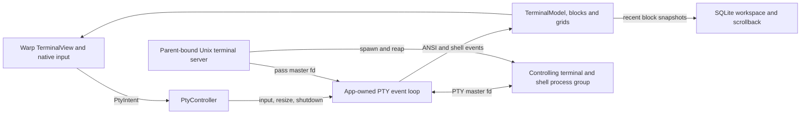
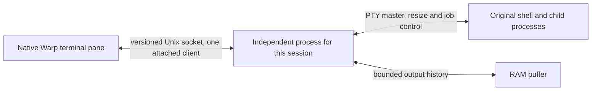

# Persistent local terminal sessions

Draft technical specification for [#9416](https://github.com/warpdotdev/warp/issues/9416). The base is [upstream master at f7fc2f2](https://github.com/warpdotdev/warp/commit/f7fc2f2a08a3aa446baa23960710e630c5defd6e), verified against the live GitHub ref on November 6, 2026.

## Context

- The app builds a terminal surface and starts its I/O thread in [TerminalManager](../../app/src/terminal/local_tty/terminal_manager.rs#L1228). The reusable local Unix PTY code now lives in `crates/warp_terminal`. [PtySpawner](../../crates/warp_terminal/src/local_tty/spawner.rs#L186) uses the terminal server with direct spawn fallback. [Unix spawn](../../crates/warp_terminal/src/local_tty/unix.rs#L463) uses `openpty`, establishes the child’s session and controlling terminal, and wires stdin, stdout, and stderr to the slave. The server sends the master fd to the GUI and monitors children. The GUI owns I/O and resizes through the master. [Terminal server](../../crates/warp_terminal/src/local_tty/server/mod.rs#L136), [PTY event loop](../../crates/warp_terminal/src/local_tty/event_loop.rs#L333)
- Normal terminal teardown shuts down and joins the event loop. Its [shutdown path](../../crates/warp_terminal/src/local_tty/event_loop.rs#L503) can kill the PTY child. App termination also drops the ordinary terminal server, which monitors its parent and tears down its children. Update relaunch explicitly requests PTY shutdown in the terminal view. Persistence must survive both this orderly shutdown and the loss of all GUI descriptors on a crash. [Manager shutdown](../../app/src/terminal/local_tty/terminal_manager.rs#L640), [server parent detection](../../crates/warp_terminal/src/local_tty/server/event_loop.rs#L225), [update path](../../app/src/terminal/view.rs#L13678)
- Workspace persistence saves pane trees, IDs, working directories, and recent block data in SQLite. These describe the UI and supply data for a new surface on restore. They contain no attachable live master fd. [Persistence overview](../../app/src/persistence/README.md), [app-state writer](../../app/src/persistence/sqlite.rs#L917)
- The ANSI parser and terminal model handle output, grids, alternate-screen state, and terminal responses. Shell bootstrap adds prompt and command markers and metadata used by structured blocks, native editor, completion and history. Those parts also depend on session initialization, event ordering, and UI-side state. CLI-agent listeners observe terminal events and do not own process lifetime. [Terminal model](../../app/src/terminal/model/mod.rs), [bootstrap files](../../app/src/terminal/writeable_pty/bootstrap_file), [native input](../../app/src/terminal/input.rs), [CLI-agent sessions](../../app/src/terminal/cli_agent_sessions)

## Upstream overlap

| Work | Status and scope |
| --- | --- |
| [#9416](https://github.com/warpdotdev/warp/issues/9416) | Open with `needs-info` and no readiness label. Local long-running commands are a priority and the discussion distinguishes process continuity from CLI resume. |
| [#8492](https://github.com/warpdotdev/warp/issues/8492) and [#14864](https://github.com/warpdotdev/warp/pull/14864) | Open tmux support issue and spec PR. The current API shows `enhancement` and `moonshot`. The older spec description records `ready-to-spec`. The spec includes native tabs and panes, tmux-owned history, control protocol flow control, and repaint on TUI reattach. The author [reports five implementation branches](https://github.com/warpdotdev/warp/issues/8492#issuecomment-6692405524). |
| [#15629](https://github.com/warpdotdev/warp/pull/15629) | Open, unmerged research prototype behind `tmux_control_prototype` on its branch. It opens a dedicated native tmux window and hides the Warp editor for tmux panes. Its PR reports protocol tests and says live GUI validation is outstanding. |
| [#2106](https://github.com/warpdotdev/warp/issues/2106) and [#10185](https://github.com/warpdotdev/warp/issues/10185) | Closed. The former points to [SSH connection management discussion #442](https://github.com/warpdotdev/warp/discussions/442). The latter asks for opt-in re-execution on restore. |
| [Remote fork spec](https://github.com/ATERCATES/warp/commit/b39985e529eb1924f4f56b3fd50364f0f58dc094) and [SSH tmux panel](https://github.com/ATERCATES/warp/commit/b51b91fd7c76b801b9fd4ab70215f8d33f8f3bd7) | Related prior work on remote sessions. The roadmap also lists local and SSH persistence separately from tmux control mode. [Roadmap #9233](https://github.com/warpdotdev/warp/issues/9233) |
| [#12205](https://github.com/warpdotdev/warp/pull/12205), [#14070](https://github.com/warpdotdev/warp/pull/14070), [#15174](https://github.com/warpdotdev/warp/pull/15174), [#16511](https://github.com/warpdotdev/warp/pull/16511) | Ordinary PTY teardown, restored split-pane state, deferred scrollback, and preservation of macOS signing identity during an update. These paths may intersect with integration or validation. |
| [#16148](https://github.com/warpdotdev/warp/pull/16148) and [#16330](https://github.com/warpdotdev/warp/pull/16330) | Merged cloud-only replacement-shell recovery and an ACP transport using an existing PTY. |

Searches included open and recently merged issues and PRs for persistent terminals, detach and reattach, PTY lifecycle, terminal server and daemon, restoration, and tmux control mode. The base has the ordinary Unix terminal server and cloud and SSH terminal paths. No merged general-purpose local PTY persistence or tmux control-mode feature flag was found.

## Options

| Approach | Functionality and fidelity | Cost and compatibility |
| --- | --- | --- |
| New independent PTY daemon | Preserves original local processes and provides a byte-transparent path to the native terminal. | A new spawn path and full catalogue introduce parallel shell behavior, service lifecycle, and protocol maintenance. |
| Native tmux control mode | Existing tmux owner preserves processes and screen history. Warp can render native tabs and splits. Control-mode parity for structured blocks, OSC events and native editor needs shell bootstrap and protocol work. | Requires compatible tmux and changes server, pane and terminal semantics. Coordinate with the existing spec and prototype for this route. |
| Existing Warp terminal plus a persistent PTY owner | Reuse Unix PTY setup and native ANSI/model rendering. Keep ordinary PTYs on their existing teardown path. Persistent panes can start with direct shell I/O. | Requires a narrow local protocol and a replay strategy. A per-session owner avoids an always-running service in the proof and limits a helper failure to its session. |

Use the third approach for the local macOS proof. An update-only fd transfer leaves a gap for force quit and crash, and still needs an owner to read output while the GUI is absent.

## Proposed changes

- Keep process creation and termination separate from attachment. Start the independent owner only for explicit persistent creation. Keep it outside the ordinary `PtySpawner` server’s lifecycle. The owner retains the PTY master and handles output even with no connected GUI. Detach closes the client transport. Termination is a distinct, explicitly requested operation with child reaping.
- Reuse the existing Unix spawn and resize primitives as appropriate. Keep the native terminal parser and rendering in the GUI and route output, input, and resize through a persistent backend. In the first proof, use standard shell input and output. Take explicit care around parser-generated terminal responses during replay so old output never sends input or responses to the running PTY.
- Store stable opaque session IDs. Use an owner-only runtime directory and Unix socket, reject unsafe path metadata, verify the peer’s effective UID on macOS, and version and bound IPC messages. Hold one active writer lease per PTY and release it when the client disconnects. Never treat a failed connection as authorization to spawn a new shell.
- Bound output retention and pending writes. Serialize attachment and live output to prevent loss, duplication, or reordering around the replay boundary. Define a visible truncation state and what a client can reconstruct after the oldest bytes are evicted. Do not use unbounded logs or expose terminal bytes over the network.
- Document which capabilities need a later model-state or shell-integration design. A tail of raw bytes alone cannot reconstruct colors or modes set before the retained range, partial escape sequences, full scrollback, Warp input state, and alternate-screen contents. A resize can prompt an interactive application to repaint, but applications vary. Signals and cleanup must respect foreground process groups and account for job control and descendants that escape the session.
- Persist the owner UUID with the terminal pane snapshot using the existing SQLite terminal record and an explicit persistence marker. Restore a native disconnected pane first. An opt-in environment preference starts attachment off the UI thread. The original pane UUID remains usable for manual attachment if the owner is missing, busy, ended, or incompatible. Production update and TCC behavior require a signed release test.

## Testing and validation

1. Build the debug macOS `warp-oss` bundle from the isolated clone under a distinct `WARP_DATA_PROFILE`. Verify the build’s app identity and exact PID before launching or terminating anything. Record the build SHA and the session, shell, workload, and GUI process IDs.
2. In a new persistent pane run `sh -c 'n=0; while :; do n=$((n+1)); printf "pid=%s tick=%s\\n" "$$" "$n"; sleep 1; done'`. Save the visible workload PID and counter. Quit the GUI with Cmd+Q and verify that the isolated GUI process has exited. Check that the recorded workload PID is alive while Warp is closed. Reopen the same build and profile, attach manually, and verify the same PID, output from the disconnected interval, and live increasing ticks. Send Ctrl+C and verify the original shell accepts input afterwards.
3. Repeat with explicit detach and with a forced kill of the recorded isolated GUI PID. Exercise repeat attach and an attempted concurrent attach from a second client. Test closing ordinary and persistent panes side by side, plus tab and split layouts wherever the prototype exposes them. Capture UI states and any observed mismatch.
4. Exercise ANSI output, colors, split escape sequences, an alternate-screen app such as Vim, terminal size via `stty size`, and the process’s SIGWINCH response. Check that parser-generated replies from replay do not appear in child input. Verify the shell’s own history and completion and record unavailable Warp editor and block behavior.
5. Automate original-process continuity, bounded replay and overflow, replay-to-live ordering, lease release, explicit termination/reaping, protocol mismatch, bad frame sizes, socket permissions, stale sockets, helper loss, and isolated cleanup. Add a workload that emits beyond retention while detached or with a slow client, then confirm bounded memory, retained output, a visible gap, and continuing output. Confirm that a live incompatible owner is distinguishable from a stale socket.
6. Exercise preference on and off, stable pane IDs after restart, unavailable and ended sessions, and recovery with no duplicate shells. An end-to-end autoupdate check requires an isolated signed test bundle. Record any build, platform, or signing constraints separately from executed evidence.

## Contribution path

Use the isolated prototype as evidence for maintainer discussion on #9416. Follow Warp’s readiness process before opening a spec PR and align on tmux with the existing authors. An implementation PR follows approved specs and includes manual evidence. [Contribution guide](https://github.com/warpdotdev/warp/blob/master/CONTRIBUTING.md)
